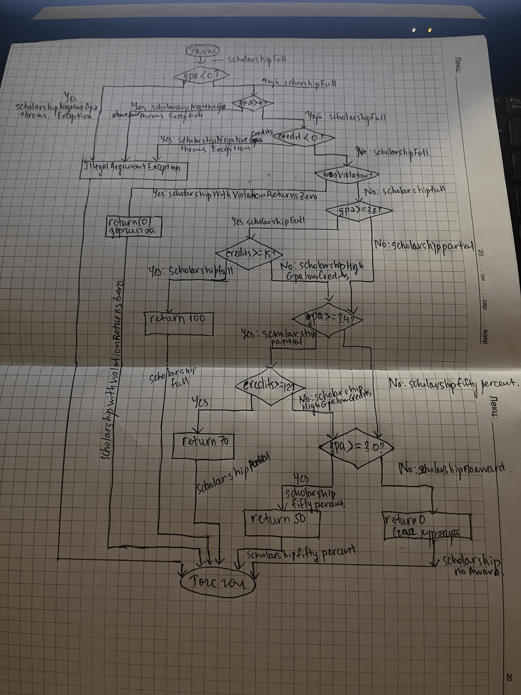

# Лаборатори №9 — JaCoCo код хамралт ба бүтцийн тест

**Хичээл:** Программ хангамжийн чанарын баталгаа ба тест (F.CSA313)  
**Оюутны код:** B222270701  
**Гүйцэтгэсэн:** Г.Ганжаргал  
**Огноо:** 2026-11-10

## 1. Зорилго

JUnit 5 болон JaCoCo ашиглан `ScholarshipCalculator` классын кодын хамралтыг хэмжих, салаалалт болон давталтын тест боловсруулах, заагийн утгын алдааг илрүүлж засах.

## 2. Ашигласан орчин

- Үйлдлийн систем: Windows 11 (64-bit)
- Java: OpenJDK 17.0.8.1, Eclipse Temurin
- Maven: Apache Maven 3.10.0
- JaCoCo: 0.8.12
- Тестийн framework: JUnit 5

**`java -version`:**

```text
openjdk version "17.0.8.1" 2023-08-24
OpenJDK Runtime Environment Temurin-17.0.8.1+1 (build 17.0.8.1+1)
OpenJDK 64-Bit Server VM Temurin-17.0.8.1+1 (build 17.0.8.1+1, mixed mode, sharing)
```

**`mvn -version`:**

```text
Apache Maven 3.10.0 (c43a36b8d67be7e0805a411bc0898af1a51f5472)
Maven home: C:\tools\apache-maven-3.10.0-bin\apache-maven-3.10.0
Java version: 17.0.8.1, vendor: Eclipse Adoptium, runtime: C:\Users\gnjaa\AppData\Local\Programs\Eclipse Adoptium\jdk-17.0.8.101-hotspot
Default locale: en_US, platform encoding: Cp1252, time zone: Asia/Ulaanbaatar
OS name: "windows 11", version: "10.0", arch: "amd64", family: "windows"
```

## 3. Хэсэг A — Эхний тест ба хамралт

Эхний таван тестийг бичиж, `mvn verify` командаар ажиллуулсан.

Дараах үйлдлүүдийг шалгасан:

- `letterGrade()` — A, B үнэлгээ
- `gpa()` — хоёр онооны голч
- `scholarship()` — 100% болон 70%-ийн тэтгэлэг

JaCoCo-ийн эхний үр дүн:

| Үзүүлэлт | Хамралт |
|---|---:|
| Instruction coverage | 66% |
| Branch coverage | 51% |

Нотолгоо: `results/jacoco-A.csv`

## 4. Хэсэг B — Салаалалтын хамралт

`letterGrade()`, `gpa()`, `scholarship()` методын нэмэлт нөхцөлүүдийг тестлэсэн.

Үүнд буруу оролт, хоосон массив, сахилгын зөрчил, тэтгэлэг олгох өөр өөр нөхцөлүүд орсон.

Нийт 16 тест амжилттай ажилласан.

| Үзүүлэлт | Үр дүн |
|---|---:|
| Instruction coverage | 100% |
| Branch coverage | 100% |
| Line coverage | 100% |
| Covered branches | 41/41 |
| Covered lines | 25/25 |

Нотолгоо: `results/jacoco-B.csv`

`scholarship()` методын CFG диаграммыг `docs/scholarship-cfg.md` файлд боловсруулсан. Диаграммд `||`, `&&` операторын short-circuit нөхцөлүүдийн үнэн/худал урсгалыг тусад нь дүрсэлсэн.

## 5. Хэсэг C — Давталтын 0/1/2+ тест

`gpa()` методын `for` давталтын дараах тохиолдлуудыг шалгасан.

| Тохиолдол | Оролт | Хүлээгдэж буй үр дүн |
|---|---|---|
| 0 элемент | `{}` | `IllegalArgumentException` |
| 1 элемент | `{95}` | 4.0 |
| 2+ элемент | `{95, 85, 75, 65}` | 2.5 |

Давталтын 0, 1, 2+ удаагийн тохиолдлуудыг шалгах нь хоосон, ганц болон олон элементтэй массивыг зөв боловсруулж байгааг баталгаажуулна. Эдгээр тестүүд нь өмнө нь 100% хүрсэн Line болон Branch хамралтыг нэмэгдүүлэхгүй байж болох ч давталтын зааг дээрх логикийн алдааг илрүүлэхэд чухал юм.

Нийт 18 тест амжилттай ажилласан.

Нотолгоо: `results/jacoco-C.csv`

## 6. Хэсэг D — Заагийн алдаа илрүүлэх, засах

Спецификацийн дагуу 60 оноо авсан оюутан `D` үнэлгээ авах ёстой.

Анхны код:

```java
if (score > 60) return "D";
```

Алдааг илрүүлэх тест:

```java
@Test
void letterGradeSixtyShouldBeD() {
    assertEquals("D", calculator.letterGrade(60));
}
```

Тестийн үр дүн:

```text
expected: <D> but was: <F>
BUILD FAILURE
```

Унасан тестийн нотолгоо: `results/mvn-test-D-fail.txt`

Алдааг дараах байдлаар зассан:

```java
if (score >= 60) return "D";
```

Засварын дараа `mvn clean verify` командыг ажиллуулсан.

Эцсийн үр дүн:

```text
Tests run: 20, Failures: 0, Errors: 0, Skipped: 0
BUILD SUCCESS
```

Засварын дараах JaCoCo тайлан: `results/jacoco-D.csv`

Алдааг илрүүлсэн болон зассан өөрчлөлтүүдийг тусдаа Git commit-оор хадгалсан.

Branch coverage 100% болсон нь програмын бүх салааг тестээр гүйцэтгэсэн гэсэн үг боловч логик алдаагүйг бүрэн батлахгүй. `score > 60` болон `score >= 60` нөхцөлүүд нь өмнө ашигласан тестийн утгуудад ижил салааллын үр дүн өгч байсан учраас JaCoCo энэ алдааг илрүүлээгүй. Харин `letterGrade(60)` гэсэн зааг утгын тест нэмэхэд хүлээгдсэн `D` дүнгийн оронд `F` буцаж, алдаа илэрсэн. Үүнийг `score > 60` нөхцөлийг `score >= 60` болгон өөрчилж зассан бөгөөд дараа нь бүх тест амжилттай ажилласан. Иймээс кодын хамралт нь ямар мөр, салаанууд гүйцэтгэгдсэнийг хэмждэг боловч програмын үр дүн зөв эсэхийг батлахгүй тул зааг утгын тест зайлшгүй шаардлагатай юм.

## 7. Git-ийн ажлын түүх


| Хэсэг | Commit | Тайлбар |
|---|---|---|
| A | `3041592` | Эхний тест болон JaCoCo тайлан |
| B | `c69ea11` | Салаалалтын тестүүд |
| B — CFG | `451a5b1` | CFG диаграмм |
| C | `97a702b` | Давталтын тестүүд |
| D — алдаа | `c0b20e9` | 60 онооны алдааг илрүүлсэн |
| D — засвар | `78d778a` | 60 онооны заагийг зассан |

## 8. Дүгнэлт

JaCoCo ашиглан кодын хамралтыг хэмжиж, тестээр хамрагдаагүй салааллуудыг тодорхойлон нэмэлт тест боловсруулсан.

Хэсэг B-д Line болон Branch coverage 100%-д хүрсэн. Хэсэг C-д давталтын 0/1/2+ тохиолдлыг шалгасан.

Хэсэг D-д 60 онооны зааг дээрх алдааг тестээр илрүүлж, засварын дараа бүх тест амжилттай ажилласныг баталгаажуулсан.

Кодын хамралт 100% байх нь бизнес логикийн бүх алдаа байхгүй гэсэн баталгаа биш болохыг 60 онооны заагийн алдааны туршилтаар харуулсан.

## CFG зураг


Хэсэг A: Line coverage 60% (15/25), Branch coverage 51% (21/41).
AI туслахыг код, тест, тайлан боловсруулах заавар болон алдаа шалгахад ашигласан.
