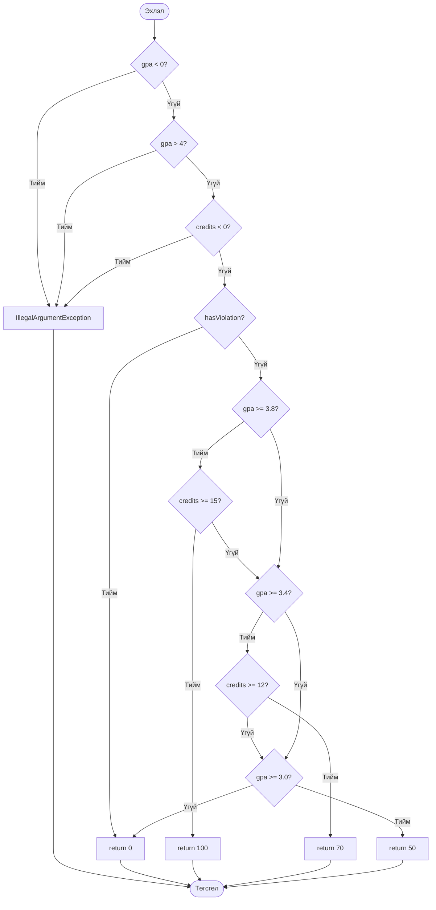

# ScholarshipCalculator — Control Flow Graph (CFG)

## scholarship() методын удирдлагын урсгал

## Тайлбар

- Эхний гурван нөхцөл нь буруу оролтыг шалгана.
- Сахилгын зөрчилтэй бол тэтгэлэг 0 байна.
- Голч болон кредитийн нөхцөлөөс шалтгаалан 100%, 70%, 50% эсвэл 0% тэтгэлэг олгоно.
- `||` болон `&&` операторуудын short-circuit үнэлгээг тусад нь харуулсан.
- Хэсэг B-ийн JaCoCo үр дүн: **Line 100%, Branch 100% (41/41)**.
- Нотолгоо: `results/jacoco-B.csv`.
